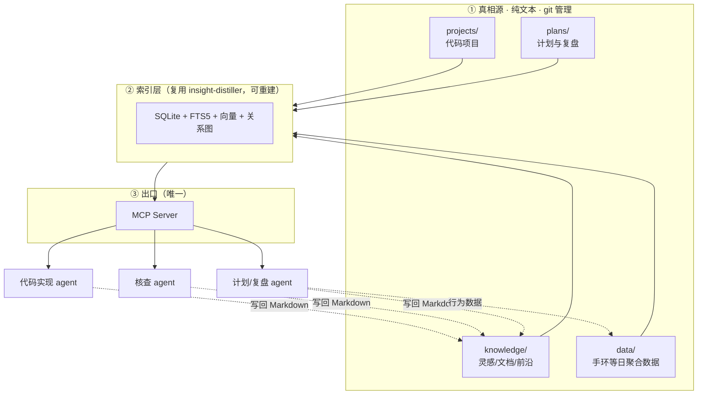

# PLAN · 整体目标规划

> 状态：规划完成，待开工 ｜ 版本：v1.0 ｜ 最后更新：2026-10-13
> 详细论证见 `docs/`；正式需求见 `PRD.md`；当前进度见 `PROGRESS.md`；关键取舍见 `DECISIONS.md`。

---

## 1 · 愿景

**把个人 / 小团队在使用 AI 过程中产生的一切——灵感、文档、发现、代码、计划、执行记录——沉淀成一个 AI 自己能读懂的知识库，再用这个知识库反过来支撑五类能力：存档、检索、实现、核查、干涉现实。**

一句话判据：**假设明天所有 AI 厂商全部关停，这些知识还剩多少？** 答案必须是"全部完好地在本地 Markdown 文件里"。

---

## 2 · 两条大前提（贯穿所有决策）

| # | 大前提 | 落地动作 |
|---|---|---|
| **P1** | 有好的现成实现就复用，优先于重复造轮子 | 每个模块开工前先查"市面上有没有"；已查明约 80% 的检索/知识管理能力可直接复用 `insight-distiller`（见 `PRD.md` 全局依赖） |
| **P2** | 这是基建工作，核心是知识管理，目的是让后续的 AI 能读取，再实现其他能力 | 真相源必须是纯文本文件；索引必须可从真相源重建；对外只开一个 MCP 出口；元数据必须结构化 |

---

## 3 · 整体架构（一张图）



**五个应用模块，不是五个并列系统，是一个闭环**（详见 `PRD.md` §0）：

```
现实 ──▶ Part 1 图书馆(真相源) ◀── Part 2 外部检索(入口)
            ▲                              │
            └── Part 5 计划(回流) ◀── Part 3 代码实现(出口) ──▶ 现实
            Part 4 可行性核查 = 横切层，不单独占数据
```

---

## 4 · 范围

### 本次规划覆盖（In Scope）

| 模块 | 一句话定义 |
|---|---|
| Part 1 · 迷你图书馆 | 一小群人的灵感 / 文档 / 前沿方向，关联检索能力优秀的知识库 |
| Part 2 · 外部检索 | 主动搜 + 自动抓外部信息，带丢弃机制，不淹没自己 |
| Part 3 · 代码实现 | 点子到可运行代码，防止半成品堆积 |
| Part 4 · 可行性核查 | AI 扮演"反对者"，在陌生领域避雷，内嵌于其他模块 |
| Part 5 · 计划系统 | AI 制定计划 + 低摩擦采集执行数据 + 复盘归因，用来真正改变行为 |
| 题外话 · AI 文娱 | 不是新模块，是前五个模块在"AI 影音/漫剧/小说"领域的一次应用 |

### 明确不做（Out of Scope，详见 `DECISIONS.md`）

- 不建 Wiki / 博客前端
- 不做健康管理系统（Part 5 的健康数据只是行为改变的输入之一）
- 不自建爬虫框架 / 调度器
- 不引入第二套笔记工具作为知识库主体
- 不做多人实时协作 / 云同步（走 git 异步协作）
- 不做移动端 App

---

## 5 · 里程碑（Checkpoint）

| Checkpoint | 核心交付 | 验收标准 | 前置依赖 |
|---|---|---|---|
| **C1 地基** | `kb/` 目录 + 三类 frontmatter 约定 + 接入检索层 + 一个真实入库样例 | AI 经 MCP 读到知识库并复述内容；新入库自动提示 ≥1 条关联 | **B1 手环确认**（不阻塞 C1，但阻塞 C2） |
| **C2 计划闭环** | 手环数据管道 + 计划模板 + 复盘归因框架 | 连续 7 天零人工操作有数据；产生 ≥1 条被执行的建议 | C1 |
| **C3 项目模板** | README/PLAN/PROGRESS/DECISIONS 脚手架 + 复现 checklist + 状态纪律 | AI 读 `PROGRESS.md` 复述现状；无"状态不明"项目 | 无 |
| **C4 核查能力** | 核查 prompt 内嵌到 Part 1/3/5 流程 | 输出无空话；出现过"不知道"；≥3 条被拦下的案例 | C1、C2 |
| **C5 外部供料** | `survey` 综述命令 + 抓取接入 + 丢弃机制 + 播客 RSS | 综述输出可独立核实；Push 模式连续 30 天每天主动读 ≥1 条 | C1 |
| **C6 文娱应用** | AI 文娱作为第一个 Domain 跑通 | 产出案例，不产出新系统 | C1-C5 |
| **C7 成本治理** | 模型分级路由 + 月度账单复盘 | 月账单可归因到任务类型；重复劳动零花费 | 全程贯穿 |

**排序理由（反直觉之处，详见 `docs/05_Roadmap与风险.md` §2）：**
- C2 排在 C5 前：Part 5 每天自动积累、有复利；Part 2 按需触发，晚两周无损失。
- C3 排最后一组开工但不晚于 C4：代码实现依赖前面模块供料，过早做只会产出空模板。

---

## 6 · 全局成功判据

| # | 判据 |
|---|---|
| 1 | `rm -rf` 索引目录后，知识库能从 Markdown 完全重建，零丢失 |
| 2 | 对外只有一个出口（MCP），无第二个消费入口 |
| 3 | 任意模块的 agent 开工前先查 `kb_stats` 确认边界，不臆断 |
| 4 | 没有"状态不明"的项目（全部有明确状态标记） |
| 5 | Part 5 用户每日主动操作次数 = 0 |
| 6 | Part 4 的核查输出里出现过"不知道" |
| 7 | 自动抓取有可观测的"过滤掉 N 篇"统计，不是无脑全收 |

---

## 7 · 下一步

1. **确认 B1**（手环能否自动导出 CSV）—— 唯一可能让 Roadmap 重排的变量
2. 开 C1：建 `kb/` 目录骨架，接入 `insight-distiller` 检索层
3. `git init` 本规划仓库，纳入版本管理
