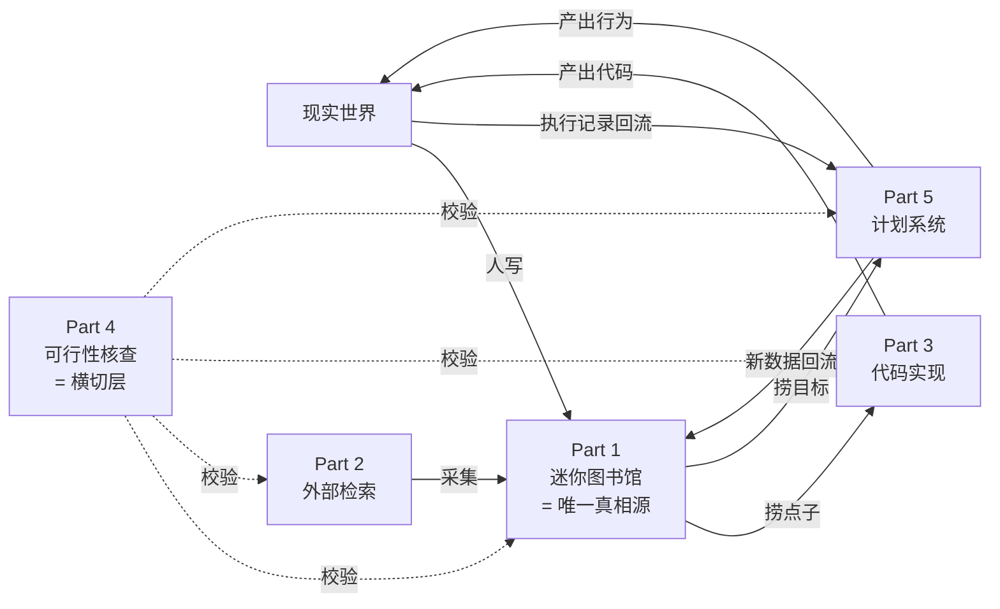

# 01 · 需求对齐

> 目的：把会议小结 + 用户订正，还原成**可判定、有边界**的需求。
> 每个 Part 回答四个问题：**本质问题是什么 / 真实难点在哪 / 怎么算做成了 / 不做什么**。

---

## 全局：五部分的真实关系

会议小结把它们列成"五大核心模块"，读起来像五个可以并行立项的东西。但按**数据流向**看，它们的角色完全不同：



三条关键结论：

1. **Part 1 是唯一的数据汇点（sink）**。Part 2 往里写，Part 3/5 从里读。这意味着 **Part 1 的知识管理做不好，其他四个模块全都缺养分** —— 这正好印证了用户的大前提 P2。
2. **Part 4 不是模块，是能力层**。它没有自己的数据，它的价值体现在"拦住另外四个模块的错"。把它做成独立系统必然失败——因为没人会主动去"跑一个核查工具"。
3. **Part 5 是唯一自带回流闭环的**。Part 3 产出代码后项目就结束了；Part 5 产出行为后会产生新数据，回流进 Part 1。这是它成败最难、也最有价值的原因。

---

## Part 1 · 迷你图书馆

### 用户原话（含订正）

> 类似迷你图书馆的东西，用来存**一小群人**，记录**偶尔产生的灵感**、**自己撰写的一些文档**等、**发现的前沿有趣方向**，但是希望这个系统足够完善，**关联性、检索能力、管理能力**要比较优秀。

### 本质问题

**一群人零散产生的念头，怎么在几年后还能被重新找到、并自动和当时不知道相关的东西连起来。**

注意这句里有三个容易读漏的限定：

| 限定 | 意味什么 | 反对什么 |
|---|---|---|
| **一小群人**（不是一个人） | 必须有作者归属、可见性边界、冲突处理 | 否决掉一批纯单人笔记工具的默认假设 |
| **偶尔产生** | 写入频率低 → 写入体验不是瓶颈 | 优化方向不该放在"快捷输入"，应在**检索与关联** |
| **前沿有趣方向** | 这部分是**外部内容**，有时效性 | 它和"自己的灵感"生命周期完全不同，不能混在一张表里 |

### 真实难点

**难点一：三类内容的生命周期完全不同，混放必然退化。**

| 类型 | 长度 | 时效 | 归宿 | 失败方式 |
|---|---|---|---|---|
| **灵感** | 一句话~一段 | 长 | 攒着，等被激活 | 写进去就忘了，再也想不起来 |
| **自撰文档** | 长，结构化 | 长 | 是**产出物**，要能被引用 | 找不到最新版，多个版本并存 |
| **前沿方向** | 外来内容 | **短，会过期** | 要么转化成自己的判断，要么归档 | 当成"收藏夹"，攒成没人读的坟场 |

会议小结里其实已经隐隐提到了这个区分（"**独立于**灵感池建立热点追踪机制"），但没有把「文档」这一类也分出去。**正确的划分是三类，不是两类。**

**难点二：「关联性优秀」到底指什么，最容易做成玄学。**

用户要的关联性不是"有个图谱好看"，而是**被动发现**：新内容进来时，系统主动告诉你它和哪条旧东西有关。这有三个层次，缺一层就不成立：

| 层次 | 机制 | 成本 | 靠什么实现 |
|---|---|---|---|
| L1 字面 | 共同标签 / 共同实体 | 零 | 纯 SQL |
| L2 语义 | 向量近邻 | 零（本地） | 本地 embedding |
| L3 判断 | 是"引用"还是"冲突"还是"同一主题" | **要花钱** | LLM 判定，**只对 Top5 做** |

L3 才是用户真正想要的那个（"这条点子和我半年前看的某篇结论冲突"）。但它必须被漏斗限流，否则每入库一条就要过一次 LLM，成本和噪音都失控。

**难点三：多人场景下"谁的想法"和"能不能改"没说清楚。**
小团队的图书馆，一条灵感被 B 补了一笔，是改原条还是加批注？A 的判断被 C 推翻了，留不留？**这个不定，多人协作会在两周内退化成"谁也不写"。** → 见 `03_架构.md` §4 的"追加不改写"原则。

### 判定标准（怎么算做成了）

| # | 标准 | 怎么测 |
|---|---|---|
| 1 | 丢一条新东西进去，**不用手动打标签**就能看到≥1条相关旧内容 | 连续 10 次入库，10 次都有命中 |
| 2 | 一句话模糊描述（记得不精确），能搜到目标 | 用"那个讲XX的东西"这类句子检索命中率≥70% |
| 3 | 三个月后回看，能指出"这条灵感是看了 X 之后产生的" | 存在可查的溯源链 |
| 4 | 前沿方向列表里**没有超过 90 天未处理**的条目 | 定期巡检，过期即归档 |

### 不做什么

- ❌ **不建 Wiki、不建博客**。理由见 `02_复用清单.md` §1。这不是"选哪个"的问题，是**这两个都不该建**。
- ❌ 不做富文本编辑器。文档用 Markdown，图片走附件。
- ❌ 不做"全自动整理"。自动发现关联是一回事，自动修改用户的内容是另一回事——后者会让人不敢往里写。

---

## Part 2 · 外部知识检索

### 用户原话（含订正）

> 是外部知识的检索工具，但**这个也是要迭代的**，就是除了我给的这版，这个是一个**需要主动搜的**，但是还需要有一些**去网上查 ai 基建的部分**，网上已经有一些 **ai 自动抓前沿论文、热点、投资讯息的基建**了，还有这种**自动化抓的能力**。

### 本质问题

**怎么让"外部世界的变化"自动流进来，又不把自己淹死。**

用户这段话里其实点出了**两种完全不同的模式**：

| 模式 | 用户原话 | 触发 | 意图 | 主要风险 |
|---|---|---|---|---|
| **主动搜（Pull）** | "需要主动搜的" | 人 | 明确（"我要找XX"） | 搜不到 / 搜偏了 |
| **自动抓（Push）** | "自动化抓的能力" | 系统 | 探索性（"我不知道有什么"） | **噪音淹死** |

**这两种的风险方向相反，所以不能共用一套设计。**

### 真实难点

**难点一：自动抓的真正问题不是"抓不到"，是"抓到了没人读"。**

这是所有爬虫/订阅系统的共同死法。每天自动抓 30 篇前沿论文，第一周很兴奋，第三周开始不点开，第六周静默关掉——**但它还在占着你的存储和注意力预算**。

所以自动抓必须具备**丢弃机制**，而不是"收集机制"：

| 机制 | 作用 |
|---|---|
| 抓取时先算「信息密度分」 | 低分直接不进库，只在日报里留一行"今天过滤掉 24 篇" |
| 日报默认只推 Top3 | 推 30 篇等于没推 |
| 未读到期自动归档 | 90 天没碰的内容降级为"存在但不再推" |

**关键认知：自动抓系统的评价标准不是"覆盖了多少源"，而是"用户实际读了百分之几"。** 覆盖率是虚荣指标。

**难点二：用户已经明确说"网上已经有现成基建了"——这是 P1 的正确应用，但需要分辨。**

市面上这类基建分三层，混为一谈会导致重复建设：

| 层次 | 现成的东西 | 该自建的部分 |
|---|---|---|
| **数据源层** | 论文：arXiv API / HuggingFace Daily Papers / Semantic Scholar / OpenAlex（已改付费额度）<br>通用订阅：RSS / RSSHub<br>行情：各交易所公开 API | 几乎不用自建，**接入即可** |
| **调度层** | cron / 系统任务计划 / n8n / 各类 workflow 工具 | **不需要自建**，用现成的 |
| **筛选与消化层** | 这部分市面工具普遍很弱 | ★ **这才是自建的地方** |

一句话：**抓取和调度是商品（commodity），筛选和消化才是能力。** 把精力放在自行实现爬虫和定时器上是典型的造轮子。

**难点三：投资讯息这一类要单独标注边界。**

用户提到了"投资讯息"。这类信息有两个特殊性：
- **时效性极强**——两周前的判断可能是错的
- **观点与事实极易混淆**——自媒体口径和官方公告没法等权

这不是"加个数据源"能解决的，**必须在数据模型上强制标注 `as_of` / `authority` / `claim_type`**，否则下游任何 AI 消费它都会做出错误决策。这条是硬约束，见 `03_架构.md` §5。

### 判定标准

| # | 标准 | 怎么测 |
|---|---|---|
| 1 | 主动搜：一句自然语言 → 候选清单 + 成本预估，确认后批量消化 | 端到端跑通一次 |
| 2 | 自动抓：连续跑 30 天，**每天主动读的内容 ≥1 条** | 有阅读记录可查 |
| 3 | 自动抓：入库量与过滤量的比值可观测 | 日报里有"过滤掉 N 篇" |
| 4 | 投资类信息消费时，**每条都带时效与权威度标注** | schema 里是 required |
| 5 | 任一试听源失效时，明确报错而非静默空返回 | 有失败清单 |

### 不做什么

- ❌ 不自建爬虫框架（除少量必须的站点）
- ❌ 不自建调度器（cron / 系统计划任务足够）
- ❌ 不做"全平台覆盖"。**覆盖 5 个高频源 > 覆盖 30 个低频源**

---

## Part 3 · 代码实现

### 用户原话（含订正）

> 针对 part1 2 以及一些其他情况下，想要**复现新刷到的点子**，实现自己的一些点子，肯定要做代码实现，这里面要配套**工具、管理系统**等等。

### 本质问题

**点子到可运行代码之间，怎么不再产出"二十个半成品"。**

注意用户用了"**复现**新刷到的点子"——这个词很关键，它意味着这里其实有**两种任务形态**：

| 形态 | 特征 | 主要工作 | 失败方式 |
|---|---|---|---|
| **A 复现** | 别人已有实现，我要跑通并改造 | **读代码 + 配环境 + 最小改动** | 环境配不起来，或者改着改着改散了 |
| **B 自研** | 没有现成实现，从零写 | 设计 + 写 + 迭代 | 半途而废，或者越写越大 |

**这两种任务需要的工具完全不同**，但会议小结把它们混成"代码开发"一件事。

### 真实难点

**难点一：真正的敌人不是"写不出代码"，是"写了一半"。**

这是所有个人 / 小团队开发的通病。防止它的不是 git（git 只保证可回滚），而是**状态机**——每个项目必须处于一个明确状态：

```
设想 → 调研 → 在做 → 暂停（写清原因） → 完成 / 废弃（写清原因）
```

**"暂停"和"废弃"必须有明确原因**，否则半年后你会看到 20 个不知道为什么要停的项目。

关键判据：**如果一个项目连续 30 天没有 commit，它必须被显式标为"暂停"或"废弃"**。不允许存在"说不清状态"的项目——那才是臃肿的真正来源。

**难点二：AI 协作的瓶颈是"上下文重建"，不是"能力"。**

每次让 AI 帮忙，你要重新解释：这是个什么项目、技术栈是什么、上次做到哪、踩过什么坑。**这个成本累积起来远超写代码本身。**

解法是约定固定文件，让 AI 每次开工先读：

| 文件 | 谁维护 | 内容 |
|---|---|---|
| `README.md` | 人 | 这是什么、怎么跑起来 |
| `PLAN.md` | 人 | 需求与设计 |
| **`PROGRESS.md`** | **人和 AI 都改** | **当前状态 / 下一步 / 已知坑** ← 最关键 |
| `DECISIONS.md` | 人 | 为什么这么选（防 AI 反复推翻已定方案） |

**这四个文件不是文档，是 AI 的输入接口。** 这也是 P2（"方便后面其他 AI 读取"）在 Part 3 的具体体现。

**难点三：环境是最大的隐性成本。**
多个小项目共用一个 Python 环境 = 依赖地狱。每个项目独立虚拟环境是硬规矩，但手工维护很烦 → 用模板解决，见 `04_各模块设计.md` §3。

### 判定标准

| # | 标准 | 怎么测 |
|---|---|---|
| 1 | 新建一个点子项目 ≤ 5 分钟（含环境就绪） | 用模板实测 |
| 2 | 冷启动一个陌生项目，AI 读完 `PROGRESS.md` 能复述现状与下一步 | 实测一次 |
| 3 | **没有"状态不明"的项目** | 月度巡检清单 |
| 4 | 复现类任务有标准流程（fork / 装环境 / 跑通 / 最小改动） | 有 checklist |

### 不做什么

- ❌ 不自建 CI/CD、自建项目管理平台。**GitHub Projects + Issue 足够。**
- ❌ 不做 monorepo。个人小项目集合放一个仓库会导致所有项目的依赖和版本互相污染。
- ❌ 不追求"每个项目都写完"。**允许废弃，但必须记录原因。**

---

## Part 4 · 可行性 / 准确性核查

### 用户原话（含重要订正）

> 就是一个**分析系统**，主要是用来**核查可行性、准确性**的。这个和**核查信息源的准确性还不太一样**，他的出发点是因为这个大场景是**借助 ai 实现自己的很多想法**，但是**每个人的专业知识有限**，注定是要在**很多自己不了解的地方实现自己的想法**，所以这些领域里面的**很多坑只能靠 ai 来避雷**了。

### 这是整个需求里最需要精确的一块

用户的订正指出了一处最容易被做糊的地方。会议纪要把它叫"准确性核查"，听起来和"核查外部信息真假"是一回事，其实是两件事：

| | 信息源准确性 | **Part 4 可行性核查** |
|---|---|---|
| 问的问题 | 这条信息**本身**可信吗？ | 我**这个方案**会在哪翻车？ |
| 对象 | 外部输入 | **我自己的判断 / 计划 / 代码** |
| 时机 | 采集时 | 动手前 + 复盘时 |
| 归属 | Part 2 的职责 | **Part 4 的职责** |
| 例子 | "这是预印本还是同行评审？" | "我要用这个库，它有什么已废弃的坑？" |
| | "作者是谁，有没有利益相关？" | "我这个架构在数据量涨 10 倍时会不会崩？" |

**两者同名但对象相反。混在一起做，两边都做不好。**

### 本质问题

**在自己不懂的领域里动手，怎么让 AI 成为"避雷针"而不是"帮凶"。**

后半句很重要：**默认状态下的 AI 是帮凶**。因为 AI 天生倾向于顺着你的思路往下推（"这个方案很好，可以这样做…"），而你要的恰恰相反——你要它拦你。

### 我想补充的一个拆解：Part 4 其实是三类问题

用户说"核查可行性和准确性"，这太宽，落到实现会糊。按**事的性质**拆成三类，解法完全不同：

| 类型 | 问题形态 | 本质 | 解法 | 依赖 |
|---|---|---|---|---|
| **A 领域事实** | "这个世界现在是什么样" | **检索问题** | Part 2 支撑下的多源交叉 + 区分事实/观点 | 外部信息 |
| **B 行动陷阱** | "我这么做会在哪翻车" | **对抗性问题** | ★ **强制 AI 扮演反对者** | 无（纯 prompt） |
| **C 边界与成本** | "这想法理论上可行吗，值不值" | **约束问题** | 显式列出资源/时间/能力约束，再判定 | 需要如实提供现状 |

**B 类是核心，也是"避雷"的本义。** 它的关键设计是：**不能让 AI 自由发挥，必须强制它输出去结构化的一票否决项。**

具体做法（这是 prompt 层面能做的，不需要新系统）：

```
你不是顾问，是对手。用户要执行下面这个方案。
请找出它最可能失败的 3 个具体原因，要求：
① 每个原因是"在什么条件下会失败"，不是泛泛的风险
② 至少 1 个必须来自"用户没说、但显然没考虑到的地方"
③ 如果找不到 3 个，就直说这个方案问题不大——不要凑数
④ 禁止给安慰性表述（"总体可行，注意XX即可"）
```

第 ③ 条和第 ④ 条是关键。不写第 ③ 条，AI 会硬凑三个废理由；不写第 ④ 条，AI 会用"总体可行"把三个真问题稀释掉。

### 真实难点

**难点一：Part 4 必须是横切能力，不能是独立系统。**
没有人会主动去"跑一个核查工具"。它必须**内嵌在另外四个模块的自然流程里**：

| 在哪 | 什么时候触发 | 核查什么 |
|---|---|---|
| Part 1 写灵感时 | 标记为"想做的" | 这想法现实吗 |
| Part 2 读到一个结论时 | 结论要进知识库 | 这结论可信吗 |
| Part 3 动手前 | 写 `PLAN.md` 时 | 这方案会怎么翻车 |
| Part 5 定计划时 | 计划生成后 | 这计划能坚持吗 |

**如果 Part 4 需要用户"专门去做"，它就等于不存在。**

**难点二：AI 的知识边界必须显式暴露。**
用户说"很多自己不了解的地方"——但 AI 在那些地方**也不一定了解**，而且它不会主动说。这是最危险的状态：**双方都不知道对方不知道**。

应对：核查输出必须区分三种置信状态：

| 状态 | 含义 | 输出要求 |
|---|---|---|
| **确定** | 有明确依据 | 给出依据出处 |
| **存疑** | 知道有争议，但没把握 | 明确写"这一点需要你实际验证"，并给出验证方法 |
| **未知** | 超出知识范围 | **直接说不知道，并建议去哪里查** |

**第三类必须能说出来。** 一个不说"我不知道"的核查系统是负资产——它会给你虚假的安全感。

**难点三：核查本身也有成本，不能无脑全查。**
每个想法都做深度核查，成本和时间都不可接受。必须分层：

| 分层 | 触发条件 | 深度 |
|---|---|---|
| L0 直觉筛 | 每次都是 | 3 秒自问："这个我需要查吗"（人自己判断） |
| L1 快查 | 想法进入"想做的" | 单个 prompt，找 3 个翻车理由 |
| L2 深查 | 真准备动手了 | 多源交叉 + 领域分区 + 冲突显式化 |

### 判定标准

| # | 标准 | 怎么测 |
|---|---|---|
| 1 | 被拦住的错误判断有记录 | 累计 ≥3 条"核查后放弃/修改"的案例 |
| 2 | 核查输出**没有**"总体可行"这类空话 | 抽查输出结构 |
| 3 | 明确说出"不知道"的次数 > 0 | 如果从来没说过不知道，说明在硬答 |
| 4 | 不打断主流程 | 核查不是独立步骤，是内嵌的 |

### 不做什么

- ❌ **不做成独立工具 / 独立页面**。理由见难点一。
- ❌ 不追求"核查一切"。**只在要动手的时候认真查。**
- ❌ 不用核查结果做决策——**最终判断权在人**。AI 提供的是"你没想到的点"，不是结论。

---

## Part 5 · 计划系统（AI 干涉现实）

### 用户原话（含重要订正）

> **不是健康管理系统**，而是说一个**计划制定系统**，就是 ai 用来**干涉现实**的小系统，整体是说把**用户的各种信息、数据丢给 ai**，让 ai 制定比如**英语学习计划、专注力提升计划、膳食改善计划**等等，还能**根据用户给的信息帮用户复盘**，为什么某些计划执行得不够好，服从度够不够，是不是因为**贪玩、精力不足**等，怎么改善，这一 part 主要聚焦于**如何低成本给 ai 提供足量信息**，以及 **ai 如何制定计划以及复盘**。

### 这次订正很重要

"不是健康管理系统"这句必须写进文档，否则后面一定会做偏。健康数据在这里**只是输入之一**，不是主题。主题是：

**如何让 AI 的建议真正改变一个人的行为。**

### 本质问题

**这是一个"预测—执行—偏差归因"的闭环，不是"建议生成器"。**

AI 生成计划这件事本身没有任何难度（任何模型都能写出漂亮的英语学习计划）。**难的是后面两步**：

1. **AI 拿到的是不是真实信息**（用户会隐瞒、会忘记、会上报美化过的版本）
2. **计划执行不动的时候，AI 能不能准确归因**（是太难？不想做？没时间？还是精力不足？）

用户自己已经点出了这两点（"低成本给ai提供足量信息"、"复盘为什么执行得不够好"），非常准确。

### 关键设计原则（这是整份文档里我最想强调的一条）

> **数据必须是"行为的副产品"，不能是"额外的上报动作"。**

任何需要用户"主动填表"的方案都会在两到四周内死掉。这不是意志力问题，是**摩擦成本 > 收益**时的必然结果。

所以设计的核心动作是：**在每个领域里找到本来就存在的数字痕迹**。

| 计划类型 | ❌ 错误做法（要上报） | ✅ 正确做法（副产品） | 摩擦 |
|---|---|---|---|
| 英语学习 | "今天学了多久" | 背单词 App 的打卡导出 / 阅读器生词本 | 0 |
| 专注力 | "今天专注了几小时" | 屏幕使用时间 / 番茄钟自动记录 | 0 |
| 膳食改善 | "今天吃了什么" | 外卖订单记录 / 相册 + 时间戳 | 低 |
| 睡眠 / 精力 | "昨晚睡得好吗" | 手环自动同步 | 0 |
| 运动 | "今天运动了吗" | 手环 / 运动 App | 0 |

**"低成本"的真正含义不是"少填几个字"，而是"用户什么都不用做"。**

只有在找不到副产品的时候，才退而用"极简上报"（一个数字、一次点击），并且要接受这个计划大概率坚持不了。

### 复盘的关键：归因框架（用户提到"贪玩、精力不足"，我把它补完整）

"为什么执行得不够好"必须有固定的归因框架，否则复盘会变成互相找借口或者自我责备。四类原因，对应四种不同解法：

| 归因 | 典型表现 | 正确解法 | 关键判据 |
|---|---|---|---|
| **① 能力不足**（太难） | 开始后 5 分钟内就中断 | **拆小**，拆到"5 分钟能开始" | 中断点集中在开头 |
| **② 动机不足**（不想做） | 压根没开始，但不是没时间 | **换目标或重定意义**——这个目标真是你要的吗 | 有整块空闲时间但没做 |
| **③ 环境不利**（没时间/被打断） | 开了头但被外部打断 | **改场景**：换时间、换地点、切通知 | 中断点分散在全程 |
| **④ 精力不足**（疲劳） | 计划完成度整体下滑 | **先解决上游**——这往往不是自律问题 | **多个计划同时下滑** ← 关键信号 |

**第 ④ 类是本设计最有价值的一处洞察：**

> **如果多个不相关的计划同时出现执行率下滑，原因几乎不可能是"自律变差了"，而是上游输入（睡眠/健康）出了问题。**

这条推论带来两个直接结果：

1. **它解释了为什么需要采集精力指标**。不是为了"管理健康"，而是因为**精力是所有其他计划的前置变量**。这让 Part 5 和手环数据的关系变得自然——数据放进来是因为它影响别的计划，不是因为"我们想管健康"。
2. **它给出了一个可操作的诊断顺序**：先看"是不是多个计划同时下滑"，是 → 查上游；否 → 再看单计划归因。

### 真实难点

**难点一：数据量必须"AI 读得起"。**

用户说"足量信息"，但"足量"不等于"多"。**上下文是有配额的（token 就是钱）**，所以采集量必须压到 AI 能每天读的程度：

| 采集方式 | 每天数据量 | AI 能读吗 | 判断 |
|---|---|---|---|
| 低清截图（每分钟 1 张） | 1440 张 | ❌ | 只做**异常时取证**，不做常态 |
| 手环秒级心率 | 86400 点 | ❌ | 必须日聚合 |
| **手环日聚合**（睡眠/静息心率/深睡/步数） | **约 80 token** | ✅ | ★ 正确粒度 |

**结论：先做日聚合，截图只做兜底。** 会议纪要把两者并列了，实际上成本差三个数量级。

**难点二：AI 制定计划必须有限制条件，否则产出等于废话。**

同样一套约束（从实操中总结的）：

```
计划生成后的三条硬约束：
① 第一步必须能在 5 分钟内开始（做不到 → 计划无效）
② 一次只给一条建议（给五条 → 一条都不执行）
③ 必须明确"什么时候、在哪里、做什么"（否则等于没说）
```

**第 ② 条最反直觉也最重要**：给用户 5 条建议，实际结果是 0 条被执行；给 1 条，执行率反而高。市面上的健康/学习类 App 都栽在这里。

**难点三：用户会不自觉地上报美化过的版本。**
应对方式不是"抽查惩罚"，而是**优先用无意识的副产品，其次用工具记录，最后才用自述**。数据源的优先级排序本身就是防隐瞒机制。

### 判定标准

| # | 标准 | 怎么测 |
|---|---|---|
| 1 | 用户**每日主动操作次数 = 0** | 数据全自动流入 |
| 2 | 连续 14 天有数据 | 中断即失败 |
| 3 | 产生过 ≥1 条**被实际执行**的建议 | 有执行记录 |
| 4 | 复盘能区分四类归因，而不是笼统说"坚持不够" | 抽查复盘输出 |
| 5 | 出现"多计划同时下滑"时，能指向上游原因 | 有诊断记录 |

### 不做什么

- ❌ **不做健康管理系统**。健康数据只是输入之一。
- ❌ 不做多计划并行推进。**先跑通一个计划**。
- ❌ 不做"提醒/打卡"功能——那是摩擦，不是助力。
- ❌ 不做"建议生成器"。**能生成建议但拿不到执行数据的系统 = 白做。**

---

## 题外话 · AI 文娱（教程 / 学习计划 / 行业分析）

### 用户原话

> 辅助用户 ai 娱乐，相关于影音视频、ai 漫剧、ai 小说等相关的小方向，能不能**制定教程、制定学习计划、帮助上手、分析行业方向**等等，我觉得这些都是**可以给予前面的几大模块实现的**。

### 我的判断：同意，而且这正好验证了前面的架构

用户的判断是对的。把它逐项映射到已有模块：

| AI 文娱要做的事 | 实际上是 | 归属 |
|---|---|---|
| 制定教程、沉淀方法 | 写**文档** | Part 1 |
| 制定学习计划、跟进度 | 制定**计划** + 复盘 | Part 5 |
| 分析行业方向、追踪工具 | **外部检索** + 综述 | Part 2 |
| 核查"这个方向能不能做" | **可行性核查** | Part 4 |
| 实际上手试一遍 | **代码/项目实现** | Part 3 |

**结论：AI 文娱不是一个新模块，是前五个模块的一个应用场景（Domain）。** 这也正是好架构的特征——不需要为新领域加新模块。

### 但要立一条纪律

这是会议待办里**最危险的一条**，因为它听起来最轻松（"各自认领一个方向实践探索"）。

| 风险 | 后果 | 纪律 |
|---|---|---|
| 探索性任务抢主线的注意力 | 五个模块都做一半，文娱也没做成 | **只在前四个模块的框架内做**，不为它开新系统 |
| "制定教程"变成无边界大工程 | 写不完，不了了之 | **一篇教程 = 一次 Part 1 的入库**，不做"课程体系" |
| 产量导向 | 追数量，质量崩 | 判据是"我自己上手成功了吗"，不是"写了多少" |

**一句话：AI 文娱的正确用法是"用它来验证前五个模块好不好用"，而不是"再建一个系统"。** 如果做教程的时候发现 Part 5 的计划功能用不了，那是 Part 5 该改——这才是探索的价值。

---

## 附：五部分的优先级（不是并列做）

| 顺序 | 模块 | 为什么排这个位置 |
|---|---|---|
| **1** | **Part 1 迷你图书馆** | 唯一的真相源。它不做好，其他四个全部缺养分。**而且是唯一"越早开始积累越值钱"的** |
| **2** | **Part 5 计划系统** | 唯一自带回流闭环的。跑通后每天自动产生数据，**复利效应最强** |
| **3** | **Part 2 外部检索** | 给 Part 1 供料。但它是按需触发，晚两周没损失 |
| **4** | **Part 4 可行性核查** | 依赖 Part 2 的外部信息支撑，且要在前几个模块的使用中才能验证有效性 |
| **5** | **Part 3 代码实现** | 前四个都在为它供料。且它的问题（半成品）在点子多了之后才出现 |

**排序的两个反直觉之处：**

- **Part 5 排在 Part 2 前面**：看起来"外部检索"更基础，但 Part 5 是**每天自动积累**的，Part 2 是**按需触发**的。先跑会产生复利的那一个。
- **Part 3 排最后**：直觉上"写代码"是最硬的活应该先做，但 Part 3 的产出依赖前面几个模块的输入质量。**先做 Part 3 会做出一堆没有素材的空模板。**

