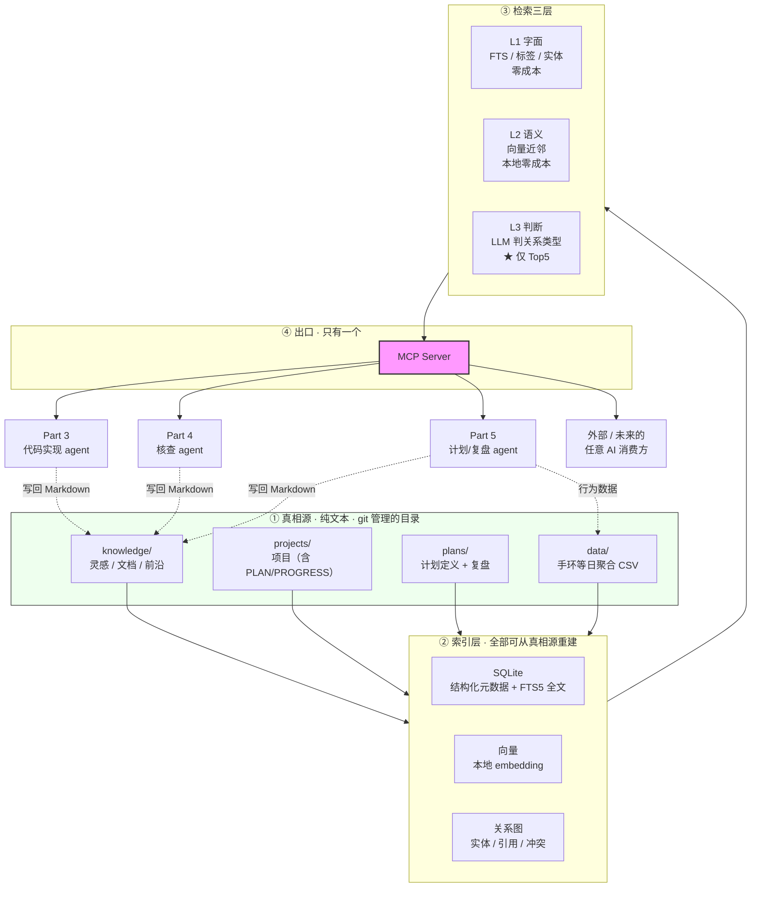

# 03 · 架构

> 落地大前提 **P2：这工作偏基建，核心是把知识管理做好，方便后面其他 AI 读取，再实现其他能力。**
> 这份文档是整个方案的地基。**先定这个，再谈其他。**

---

## 1 · 由 P2 推导出的四条硬约束

P2 不是一句口号，它可以直接推出四条不可违反的设计约束：

| # | 约束 | 从 P2 的哪半句来 | 违反的后果 |
|---|---|---|---|
| **C1** | **唯一真相源必须是磁盘上的纯文本** | 「把知识管理做好」 | 数据被锁在某个工具里，工具没了知识就没了 |
| **C2** | **一切索引都必须可从真相源重建** | 「方便后面其他 AI 读取」 | 索引损坏无法恢复；换 embedding 模型就得重灌 |
| **C3** | **对外只有一个出口（MCP）** | 「实现其他能力」 | 每个消费方各自对接，契约漂移 |
| **C4** | **元数据必须结构化，不能是自然语言** | 「方便…读取」 | AI 无法可靠过滤/排序，只能全文读，token 爆炸 |

**C1 和 C2 是一对**：真相源（源）和索引（派生）必须严格分离。

> **判据：删掉整个 `data/` 目录，系统应当能完全重建——只花算力，不丢知识。**
> 如果做不到，说明有些知识只活在了索引里，那就是不可恢复的资产。

**C4 是最容易被低估的一条。** 举个具体例子：如果一条灵感只写了"这个想法和上周那篇论文有点关系"，AI 读的时候无法用它做任何事；但如果 frontmatter 里写了 `related: [paper-20261001-rag]` 和 `type: contradiction`，AI 可以直接查询和聚合。

**"结构化"的意思不是给人看的时候好看，而是给 AI 看的时候能当条件用。**

---

## 2 · 整体架构



**读这张图的三个要点：**

1. **写入只走文件**（虚线）——**任何 agent 都不直接写数据库**。数据库是派生物，被绕过的写会立刻造成源与索引不一致。
2. **出口只有一个**（MCP）。这不是洁癖：多个出口 = 多套契约 = 迟早漂移。
3. **Part 3/4/5 是 MCP 的消费方，不是并列系统**。它们通过同一个出口读知识，所以知识库升级时它们无需改动。**这就是 P2 想要的效果。**

---

## 3 · 为什么复用 `insight-distiller` 当索引与出口，而不是新建

`insight-distiller` 已经实现了上面 ②③④ 三层的大部分，且经过 465 项测试验证：

| 架构里的位置 | `insight-distiller` 的对应件 |
|---|---|
| ② SQLite + FTS5 | ✅ `store/db.py` + `schema.sql` |
| ② 向量 | ✅ 直接存 float32 于 SQLite BLOB，numpy 算余弦 |
| ② 关系图 | ✅ `knowledge/graph.py`（SQLite 递归 CTE 防环） |
| ③ L1 字面 | ✅ FTS5（含中文分词） |
| ③ L2 语义 | ✅ 本地 embedding |
| ③ L3 判断 | ✅ `knowledge/linker.py` 三级漏斗（**仅 Top5 交 LLM**） |
| ④ MCP | ✅ `agent/mcp_server.py` + HTTP + SDK，共用 Pydantic 契约 |
| 关联类型 | ✅ `cites`/`contradicts`/`supports`/`extends`/`prerequisite`/`answers`/`duplicate`/`same_topic` |
| 事实/观点分离 | ✅ claim 带 `claim_type` / `authority` / `staleness_days`（**required**） |

**注意"三级漏斗"这一项**——它正好就是架构里的 L1/L2/L3，而且已经解决了最关键的成本问题：

> **成本不随库规模增长**：引文与实体共现（纯 SQL，零成本）→ 向量召回 Top20（本地零成本）→ **仅 Top5 交 LLM 一次批量判定**。

这意味着**关联能力可以随知识库长期增长而保持成本恒定**——这是 Part 1「关联性优秀」能长期成立的工程前提。

**所以新架构不新建索引层，只做两件事：**
1. **把 `knowledge/` 目录接进现有摄入链路**（让 Markdown 能进库）
2. **复用现有 MCP 出口**，为 Part 3/4/5 各加一组查询工具

---

## 4 · 真相源的目录约定

### 4.1 完整树

```
kb/                              # 建议独立成一个 git repo（可私有）
├── knowledge/                   # ★ Part 1 的核心
│   ├── ideas/                   # 灵感：一句话~一段，长生命周期
│   │   └── 2026-10-13-低成本采集.md
│   ├── docs/                    # 自撰文档：结构化，是产出物
│   │   ├── 手环数据接入笔记.md
│   │   └── Jev-架构解析.md
│   ├── frontier/                # 前沿方向：外来内容，短时效
│   │   └── 2026-10-ai-漫剧工具链.md
│   └── inbox/                   # ★ 未分类的落地点（见 §4.4）
│       └── 2026-10-13.md
│
├── projects/                    # Part 3
│   └── <项目名>/
│       ├── README.md            # 这是什么、怎么跑
│       ├── PLAN.md              # 需求与设计
│       ├── PROGRESS.md          # ★ 状态 / 下一步 / 已知坑
│       ├── DECISIONS.md         # 为什么这么选
│       └── .gitignore
│
├── plans/                       # Part 5
│   ├── <计划名>.md              # 计划定义（目标/条目/约束）
│   └── reviews/
│       └── 2026-W42.md          # 复盘记录
│
├── data/                        # Part 5 的原始输入
│   ├── wearable/
│   │   └── 2026-10.csv          # 手环日聚合（见 §6）
│   └── screen/
│
└── ATTACHMENTS/                 # 图片等非文本附件
```

### 4.2 三类内容的 frontmatter 约定（C4 的落地）

**这是整份架构里最需要一次做对的地方。** 三类内容生命周期不同，字段必须不同：

**`ideas/` 灵感**
```yaml
---
type: idea
author: huangqian              # C1：多人，必须归属
created: 2026-10-13
status: raw | exploring | doing | done | dropped
tags: [ai, health]
related: []                    # 由系统填，不手填
source: []                     # 触发它的外部内容 id（可溯源）
---
```
> `status` 里 **`dropped` 必须存在**——不允许"说不清的灵感"永久躺在列表里。

**`docs/` 自撰文档**
```yaml
---
type: doc
author: huangqian
created: 2026-10-13
updated: 2026-10-13            # 关键：文档有版本，灵感没有
status: draft | stable | deprecated
supersedes: null               # 取代了哪篇（防多版本并存）
tags: []
---
```

**`frontier/` 前沿方向**
```yaml
---
type: frontier
author: huangqian              # 谁发现的
created: 2026-10-13
source_url: https://...
expires: 2027-01-13            # ★ 必填，外来内容的保质期
verdict: null                  # 转化成自己的判断了吗（关键字段）
tags: []
---
```
> **`expires` 和 `verdict` 是这一类独有的**，也是防"收藏夹坟场"的机制：
> - `expires` 到期未处理 → 自动转入归档，不再出现在列表里
> - `verdict: null` 超过 90 天 → 在周报里单独提示

### 4.3 多人协作：追加不改写（回应 Q1）

用户说"一小群人"。多人写入的最大风险不是冲突（git 能处理），是**不敢写**——怕自己的东西被别人改掉。

**立一条纪律：**

| 场景 | 做法 | 为什么 |
|---|---|---|
| 补充别人的灵感 | **不修改原文，追加一段带署名的批注** | 保留原始想法，防止被"优化"掉 |
| 推翻别人的结论 | **不删除，加 `contradicts` 关系** | 冲突本身是最有价值的信息（认知升级多来自发现矛盾） |
| 觉得某条过时了 | 改 `status`，**不删文件** | 保留"当时为什么这么想" |
| 文档要改版 | 改内容 + 更新 `updated` + 必要时填 `supersedes` | 防多版本并存 |

**核心原则：只有作者能改写原内容，其他人只能追加。**

这条纪律的好处不只是防冲突，它直接让 `contradicts` 关系有素材可挖——**如果允许互相覆盖，冲突就在产生的那一刻被抹掉了**。

### 4.4 `inbox/`：防臃肿的入口闸门

**所有新东西先落 `inbox/YYYY-MM-DD.md`，不直接进三类目录。**

```
任何新想法 → inbox/（纯追加，零门槛）
              ↓ 每周复盘，问三个问题
     ① 这周我用过它吗？（没有 → 继续躺）
     ② 现有工具能覆盖 80% 吗？（能 → 不建，去配现有工具）
     ③ 它是"能力"还是"一次性任务"？（一次性 → 手做，不自动化）
              ↓ 三个都过了
        分类进 ideas/ | docs/ | frontier/ → 需要动手的建 projects/
```

**这条闸门比 git 更能防臃肿**：git 只保证可回滚，不保证不臃肿。真正防止臃肿的是**入库前的准入规则**。会议纪要里把这两件事混为一谈了（原文："防止臃肿，需借助版本控制工具"）。

---

## 5 · 检索三层与"关联性优秀"的具体含义

用户要的「关联性优秀」不是"有个图谱好看"，而是**被动发现**：新内容进来时，系统主动告诉你它和哪条旧东西有关。

### 三层设计与成本

| 层 | 机制 | 成本 | 产出 | 实现 |
|---|---|---|---|---|
| **L1 字面** | FTS5（中文分词）+ 标签 + 实体共现 | **零** | 精确命中、同实体聚合 | 现成 |
| **L2 语义** | 向量近邻 | **零**（本地 embedding） | "说得不一样但意思相近" | 现成 |
| **L3 判断** | LLM 判关系类型 | **仅 Top5** | ★ `contradicts` / `answers` / `extends` | 现成 |

**L3 才是用户真正想要的那个**（"这条点子和我半年前看的某篇结论冲突"）。但它必须被漏斗限流，否则每入库一条就过一次 LLM，成本和噪音都失控。

### 入库时的被动提示（Part 1 的核心体验）

新内容进库时自动输出：

```
✓ 已入库：低成本采集方案的可行性
  密度 68/100

⚡ 发现 2 处关联
  ├─ ⚠️ 结论冲突  ideas/2026-08-15-手环数据.md
  │   本文：日聚合足够，不必采原始数据
  │   对方：原始数据才有分析价值
  └─ 🎯 可回答旧疑问  docs/手环数据接入笔记.md
       "日聚合会丢信息吗？"

  tags: ai, health · 3 个概念 · 2 条 claim
```

**注意最后一行**：不只给结论，还给**结构化的计数**（几个概念、几条 claim）——这是给 AI 消费方看的元信息（C4）。

### 检索能力的验收方式

| # | 能力 | 怎么测 |
|---|---|---|
| 1 | 新内容入库，**不用手打标签**就看到 ≥1 条相关 | 连续 10 次，10 次命中 |
| 2 | 模糊描述能搜到（"那个讲XX的东西"） | 命中率 ≥70% |
| 3 | 三个月后能指出"这条灵感是看了 X 之后产生的" | 溯源链可查 |
| 4 | `frontier/` 里没有超 90 天未处理的条目 | 巡检 |

---

## 6 · Part 5 的数据管道（唯一的前置阻塞）

**架构上最关键的一点：数据必须是"行为的副产品"，不能是"额外的上报动作"。**

任何需要用户主动填表的方案都会在两到四周内死掉。不是意志力问题，是**摩擦成本 > 收益**时的必然结果。

### 数据源优先级（从优到劣）

| 优先级 | 数据源 | 摩擦 | 可信度 | 例子 |
|---|---|---|---|---|
| **1** | **设备自动同步** | 0 | 高 | 手环：睡眠 / 静息心率 / 深睡 / 步数 |
| **2** | **系统日志** | 0 | 高 | 屏幕使用时间、App 使用记录 |
| **3** | **已有 App 的导出** | 0（导出偶尔做） | 中高 | 背单词打卡、外卖订单 |
| **4** | 极简上报（一个数字/一次点击） | 低 | **低**（会美化） | 精力自评 1-5 |
| **5** | 自由文本自述 | 高 | **很低** | "今天状态一般" |

**规则：优先用 1-3，4 只在无他法时用，5 只作为复盘的补充而不是数据源。**

这个排序本身就是**防隐瞒机制**——不靠抽查惩罚，而是优先用无意识记录。

### 数据量必须"AI 读得起"

用户说"足量信息"，但**足量 ≠ 多**。上下文是有配额的（token 就是钱）：

| 采集方式 | 每天数据量 | AI 能读吗 | 判断 |
|---|---|---|---|
| 低清截图（每分钟 1 张） | 1440 张 | ❌ | 只做**异常时取证** |
| 手环秒级心率 | 86400 点 | ❌ | 必须日聚合 |
| **手环日聚合** | **约 80 token** | ✅ | ★ **正确粒度** |

**`data/wearable/2026-10.csv` 的形状（一行一天）：**

```csv
date,sleep_min,deep_min,rem_min,resting_hr,steps,screen_min
2026-10-11,438,109,92,56,8342,214
2026-10-12,392,78,71,61,4210,318
2026-10-13,451,118,98,55,9120,186
```

**七列、一行一天。** 这个形状是刻意的：
- 每月约 30 行 ≈ 2KB，**可以永久保留**
- AI 一次读一个季度（90 行）毫无压力
- 全自动产生，零人工

**截图不进库**：本地分析完即弃，只保留结论。这既不撑爆仓库，也不涉及隐私外泄。

---

## 7 · 一次典型的数据流（把架构串起来）

以"用户戴手环 → AI 复盘 → 调整计划"为例：

```
① 采集（零人工）
   手环 App 自动同步 → 导出 CSV → data/wearable/2026-10.csv
                                        ↓
② 入库
   insight-distiller 摄入 CSV
   （作为"结构化数据"而非"文本"，直接进 SQLite）
                                        ↓
③ 检索（MCP）
   Part 5 的复盘 agent 经 MCP 查询：
     - 最近 14 天的精力指标      ← L1 字面（纯 SQL，零成本）
     - 相关计划与执行记录        ← L1
     - 历史上类似下滑时做了什么  ← L2 语义（本地零成本）
                                        ↓
④ 判断（L3，仅必要时）
   若发现"多计划同时下滑" → 交 LLM 做归因（一次调用）
                                        ↓
⑤ 输出
   复盘结果写入 plans/reviews/2026-W42.md（Markdown + frontmatter）
                                        ↓
⑥ 回流入库
   该 Markdown 进库 → 自动与历史复盘比对
     → 发现"这和 8 月那次下滑是同一个模式" ← ★ 这就是关联能力的价值
```

**注意第 ③ 步和第 ⑤ 步的关系**：读取走 SQL（几乎免费），写入走 Markdown 文件（也是免费的）——**只有第 ④ 步花一次 LLM 调用。** 这才是能长期跑下去的形态。

---

## 8 · 这条架构的验收标准

| # | 标准 | 怎么测 |
|---|---|---|
| 1 | **`rm -rf data/` 后能完全重建** | 从 Markdown 全量重建索引，知识零丢失 |
| 2 | 所有知识都是 Markdown（可直接 git、直接 cat） | `file knowledge/**/*.md` 全是文本 |
| 3 | 知识库里的每样东西都能写进 git 历史 | 有 commit 记录 |
| 4 | **只有一个出口** | 只有 MCP Server 对外，无第二个 |
| 5 | 换成任意 AI 厂商，知识库无需改动 | 换 MCP 客户端实测 |
| 6 | **假设明天所有 AI 厂商全关停，知识还剩多少** | 答案必须是"全在本地 Markdown 里" |

**第 6 条是整份架构的终极判据**，也是 P2 的真正含义。如果哪天这个答案变成"要登某个平台才能看"，说明纪律破了。

---

## 9 · 三处刻意的"不做"

| 不做 | 理由 |
|---|---|
| **不做 Wiki / 博客前端** | 已有双链导出 + 本地网页版，再建是第三套渲染层。且 **AI 读不了前端渲染**，它要的是纯文本 + 稳定路径 |
| **不引入第二套笔记工具当主体** | 会形成**三套索引**（现有库一套、新工具一套、双链导出一套）。这正是 P1 要防的臃肿 |
| **不让 agent 直接写数据库** | 数据库是派生物。绕过文件写入会立刻造成源与索引不一致，且违反 C1 |

